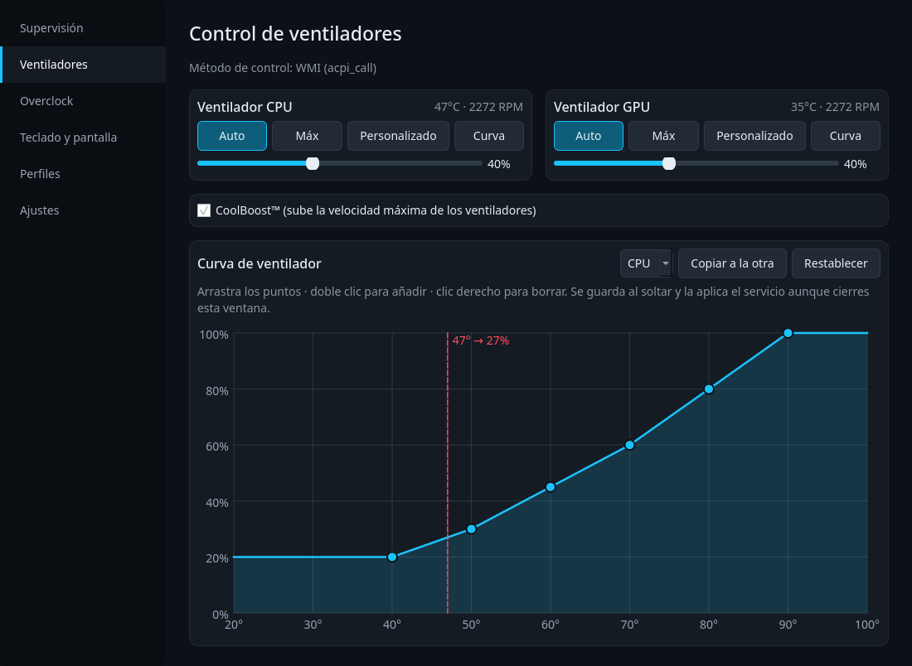
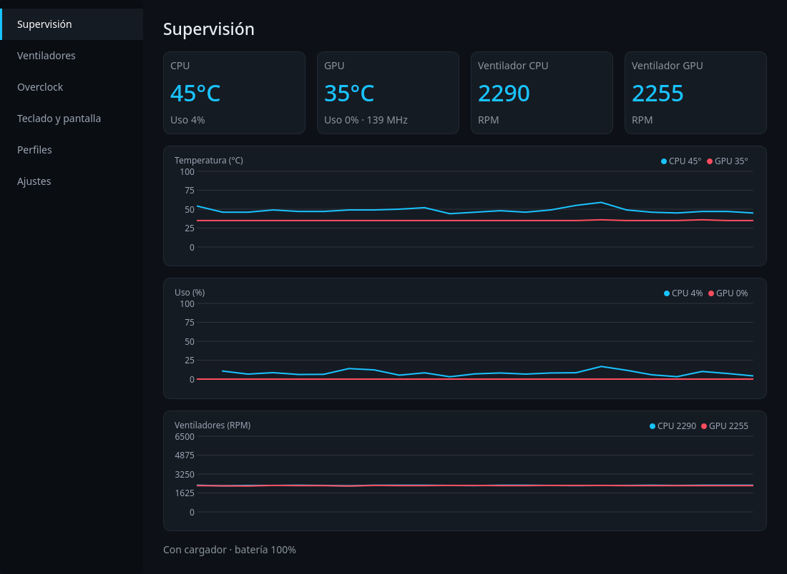
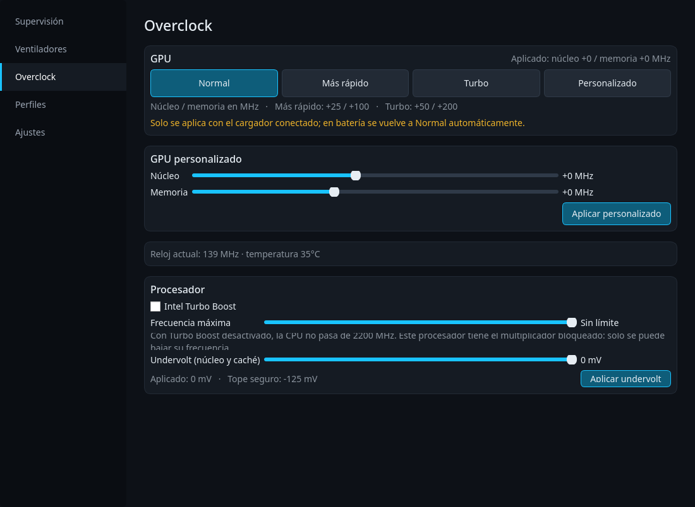
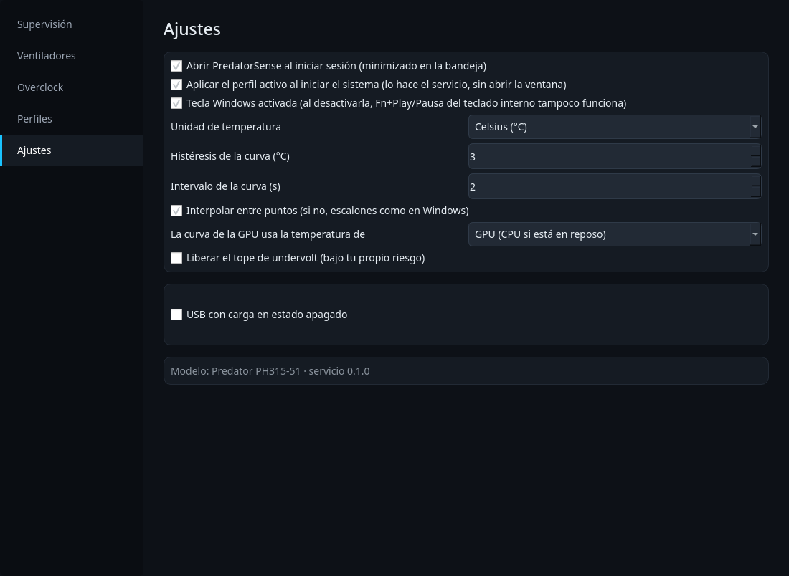

<p align="center">
  
</p>

<h1 align="center">PredatorSense para Linux · PH315-51</h1>

<p align="center">
  Control nativo de ventiladores, sensores, tecla Windows, overclock de GPU y perfiles
  para el <b>Acer Predator Helios 300 PH315-51</b> (2018, i7-8750H + GTX 1060).
</p>

<p align="center">
  
</p>

Reúne las funciones de la versión Windows de PredatorSense.
Usa **las mismas llamadas WMI de la BIOS que la versión Windows**, sacadas del MOF binario de la propia BIOS.

## Funciones

| Función | Estado en el PH315-51 |
|---|---|
| **Ventiladores** CPU y GPU por separado: Auto / Máx / Personalizado | ✅ Probado (WMI, hasta 6122 RPM) |
| **Curva de ventilador** por temperatura, una por ventilador, con histéresis | ✅ |
| **CoolBoost™** | ✅ (EC) |
| **Supervisión**: temperaturas, uso de CPU/GPU, RPM reales, gráficas | ✅ |
| **Tecla Windows** activar/desactivar, en Ajustes | ✅ Misma llamada que el original; al desactivarla también se anula Fn+Play/Pausa del teclado interno, porque la BIOS les da el mismo código |
| **USB con carga en estado apagado**, con límite de batería de 10/20/30 % (como Acer Quick Access) | ✅ |
| **Overclock de GPU** con los niveles oficiales de Acer: Normal / Más rápido / Turbo, más Personalizado | ✅ NVML, solo con cargador |
| **Turbo Boost** de la CPU activable y **límite de frecuencia máxima** por perfil, en Overclock | ✅ intel_pstate; el i7-8750H no admite subir frecuencia |
| **Undervolt** de núcleo y caché con tope de -125 mV; el tope se libera en Ajustes bajo tu riesgo | Según la BIOS: cada valor se comprueba al aplicarlo |
| **Perfiles**: crear, renombrar, borrar, importar/exportar | ✅ |
| **Reaplicar al arrancar y al volver de suspensión** | ✅ |
| **Abrir al iniciar sesión** (minimizado en la bandeja), activable desde Ajustes | ✅ |
| Icono en la bandeja con temperatura, uso y RPM de CPU y GPU al pasar el cursor | ✅ |
| `predatorsense-ctl` para la terminal | ✅ |
| Perfil de energía (`platform_profile`) | ❌ La BIOS no tiene los métodos WMI 22/23 que usa el kernel; se oculta |
| Iluminación RGB | ❌ El PH315-51 no tiene teclado RGB |

### Qué mejora respecto a la versión Windows

- **Guarda y reaplica la configuración.** Windows la guardaba en el registro, pero no la volvía a
  aplicar. Aquí un servicio la guarda en `/etc/predatorsense-linux/config.json` (escritura atómica) y la
  reaplica al iniciar y después de cada suspensión.
- **La curva funciona con la ventana cerrada.** En Windows solo corría con el editor abierto.
- **Una curva por ventilador.** Windows usaba solo la temperatura de la CPU para los dos.
- **Modo seguro.** Si el servicio se detiene o se pierde la lectura de temperatura, los ventiladores
  vuelven a automático y el overclock vuelve a cero.
- **No despierta la GPU NVIDIA** solo para leer sus sensores.

## Capturas

| Supervisión | Overclock de GPU |
|---|---|
|  |  |
| **Ajustes** | |
|  | |

## Instalación (Arch / CachyOS)

```bash
sudo pacman -S --needed python-pyqt6 acpi_call-dkms acpica
git clone https://github.com/marcedpr45/PredatorSense-PH315-51.git
cd PredatorSense-PH315-51
sudo ./install.sh
```

El instalador:
- copia el programa a `/opt/predatorsense-linux`;
- instala el servicio `predatorsensed` (systemd) y el hook de suspensión;
- configura los módulos `ec_sys write_support=1` y `acer_wmi predator_v4=1`.

Después abre **PredatorSense Linux** desde el menú.

Desinstalar:
```bash
sudo ./uninstall.sh            # conserva la configuración
sudo ./uninstall.sh --purge    # también borra la configuración
sudo ./uninstall.sh --old      # quita SOLO la versión vieja (mohsunb/PredatorSense)
```

### Terminal

```bash
predatorsense-ctl status
predatorsense-ctl fan all max          # auto | max | custom <0-100>
predatorsense-ctl fan cpu custom 60
predatorsense-ctl coolboost on
predatorsense-ctl winkey on            # off = Super no hace nada
predatorsense-ctl turbo off            # activa/desactiva Intel Turbo Boost
predatorsense-ctl cpu-max 3000         # limita la CPU a 3000 MHz (off quita el límite)
predatorsense-ctl usb on 20            # carga USB apagado; en batería se detiene al 20 %
predatorsense-ctl profiles
predatorsense-ctl profile "Juego"
```

## Cómo funciona

```
predatorsense (interfaz, tu usuario) ─┐
predatorsense-ctl (terminal) ─────────┴─ socket ─> predatorsensed (root)
                                                     ├─ WMI AcerGamingFunction vía acpi_call
                                                     ├─ hwmon acer-wmi (RPM y temperaturas)
                                                     ├─ EC (CoolBoost, respaldo de ventiladores)
                                                     └─ NVML (overclock de GPU)
```

Solo el servicio toca el hardware. La interfaz corre como usuario normal, sin `pkexec`, y el socket
solo lo pueden usar los usuarios del grupo `wheel`.

### Métodos WMI de la BIOS (V1.26)

El método ACPI es `\_SB.PCI0.WMID.WMBH`. Los IDs salen del MOF binario de la BIOS, que viene
comprimido con MRCI y se lee con `tools/bmof_decompress.py`:

| ID | Método | Uso |
|---|---|---|
| 1 | SetGamingProfile | tecla Windows, LCD Overdrive (siempre desactivado) |
| 5 | GetGamingSysInfo | temperaturas y RPM |
| 14 | SetGamingFanBehavior | modo de ventilador |
| 16 | SetGamingFanSpeed | velocidad de ventilador |

La carga USB con el equipo apagado usa otra interfaz, `APGeAction` (`\_SB.PCI0.WMID.WMAA`), igual que
Acer Quick Access: `SetFunction` (1) y `GetFunction` (2), función 4. La propia BIOS guarda el valor.

Para revisarlos en otra versión de BIOS: `sudo tools/probe.sh` (solo lectura).

### Overclock de GPU

Windows usaba NvAPI (`SetPstates20`). Aquí se usan los offsets V/F de NVML, que funcionan en Wayland.
Los niveles son los de `PredatorSense.ini` del PredatorSense oficial para esta GPU
(`DEV_1C20&SUBSYS_12631025`). NVML cuenta la memoria en tasa de transferencia, el doble que NvAPI,
así que los +50/+100 MHz de Acer equivalen aquí a +100/+200:

| Nivel | Núcleo | Memoria (NVML) | Memoria (Acer) |
|---|---|---|---|
| Normal | +0 MHz | +0 MHz | +0 MHz |
| Más rápido | +25 MHz | +100 MHz | +50 MHz |
| Turbo | +50 MHz | +200 MHz | +100 MHz |
| Personalizado | −200…+250 MHz | −500…+800 MHz | — |

Solo se aplica con el cargador conectado y se reaplica cuando la GPU sale de reposo.

### Undervolt

Usa el MSR `0x150`, igual que ThrottleStop. El tope por defecto, -125 mV, es el punto de partida habitual
entre usuarios del i7-8750H; muchos pierden estabilidad en la caché por debajo de ese valor. Cada chip es
distinto, así que prueba bajo carga antes de confiar en un valor. El tope liberado llega a -250 mV.

Si el equipo se detiene en los 2 minutos siguientes a aplicarlo, el servicio no lo reaplica al arrancar.
Un cuelgue más tardío no se detecta. Escribir ese MSR marca el kernel como *tainted* (`S`).

## Desarrollo

```bash
python3 -m unittest discover -s tests              # tests (sin root ni hardware)
python3 tools/dev_fake_daemon.py /tmp/ps.sock &    # servicio simulado
PREDATORSENSE_SOCKET=/tmp/ps.sock python3 -m predatorsense.gui.app
```

## Créditos y aviso

- Direcciones EC del PH315-51: [mohsunb/PredatorSense] (fork de PredatorNonSense de kphanipavan).
- Codificación de las llamadas WMI: deducida de [boazvdwansem/PredatorSenseDecomp], del driver
  `acer-wmi` del kernel y del MOF de la BIOS. No incluye código de Acer.
- Predator y su logo son marcas de Acer Inc. Este proyecto no está afiliado a Acer.
- Cambiar ventiladores, llamar métodos ACPI o hacer overclock es bajo tu responsabilidad.

[mohsunb/PredatorSense]: https://github.com/mohsunb/PredatorSense
[boazvdwansem/PredatorSenseDecomp]: https://github.com/boazvdwansem/PredatorSenseDecomp
